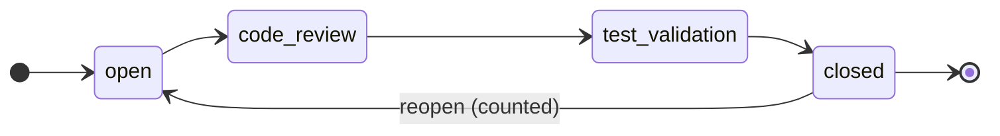
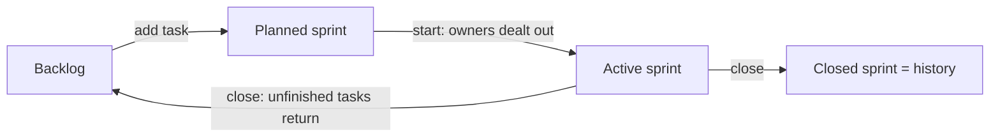
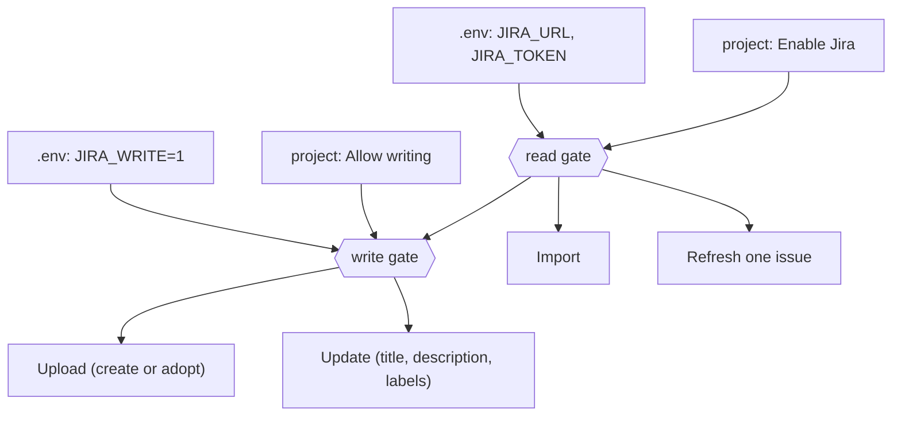
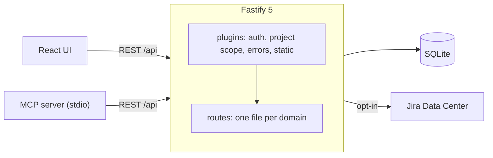

<h1 align="center">pjPlanner</h1>

<p align="center">
  <strong>Planning for dev teams, without the overhead.</strong><br>
  A simple issue tracker tied to a living map of your system, built to keep documentation and workflow in step.
</p>

<p align="center">
  
  
  
  
  
  
  
</p>

<p align="center">
  <a href="#quick-start">Quick start</a> ·
  <a href="#features">Features</a> ·
  <a href="#jira-integration">Jira</a> ·
  <a href="#connect-an-ai-agent">AI agents</a> ·
  <a href="#configuration">Configuration</a> ·
  <a href="#architecture">Architecture</a> ·
  <a href="#api">API</a>
</p>

---

## What is it?

Most trackers ask teams to adapt to the tool. pjPlanner goes the other way: it keeps only what a development team uses every day, and makes that part work well.

- **Simple by design.** Four issue types (epic, story, bug, task), four states (open, code review, test validation, closed) and one active sprint at a time. There are no custom workflows to configure and no accounts to manage. Anyone on the team can open it and start working.
- **Documentation that stays current.** You draw your system as modules and the dependencies between them. Each module records its owners and its API items, and every task points at the module it changes. The architecture map is part of the backlog, so it gets updated as the work happens.
- **A smoother workflow.** Sprints assign owners to unassigned tasks when they start, return unfinished work to the backlog when they close, and order each person's tasks by module dependencies. Less time goes on ticket upkeep and more on shipping.
- **Built for agents too.** An MCP server lets AI assistants read the plan, map a codebase into modules, and create or update issues, so documentation and tracking can keep up with the code.

It is an open team platform: no login. A single shared write key protects against accidental edits, and everyone can read.

## Features

| | |
|---|---|
| **Module graph** | Excalidraw-style card diagram (React Flow + dagre). Drag cards, auto-layout, floating arrows that attach to the nearest card border, snap guides, and group boxes drawn around member cards. |
| **Modules** | Name, description, several owners, colors, emoji icon and a list of API items. Positions persist. |
| **Overview** | Metrics-only project page (`#/overview`): a completion ring with task and step totals, key numbers, a donut of tasks by state, a **Speed** section (average and median lead time from created to closed, time per step, work time from review to closed, reopen rate, average age of open tasks, created vs closed tasks per week), highlights (hottest, coldest, fastest- and slowest-resolving module, fastest owner), owner speed bars, progress per sprint, coverage numbers (open tasks without owner / not in a sprint / without estimate, modules without owner, overloaded owners), work by owner (tasks and steps done, steps left, no ranking), a module heat map (completion, missing owners, dependents) and epic rings. Everything is a snapshot derived from issues, estimates and sprints (times use the server's timestamps, so they only exist for tasks closed in pjPlanner after this was added; Jira refreshes and project imports leave them unknown). Owners get the same numbers on their own page. |
| **Owners & groups** | Owners list (`#/owners`): cards with modules, open tasks, steps left, completion and time per step, fuzzy search and sorting. Each owner has their own page (`#/owners/<id>`, `#/owners/new`) like issues: completion ring, tasks by state, steps left and share of the team's load, load rank, lead time and time per step compared with the team, reopens, tasks closed per week, progress per module and their tasks by sprint, with name, colour, icon and modules edited in place and saved or discarded together (removing a module that holds their unfinished tasks unassigns them after a confirmation). Groups nest up to 4 levels deep to organise modules by topic. |
| **Issue tracker** | `epic` / `story` / `bug` / `task` hierarchy. Tasks carry a module, an assignee (who must own that module), a sprint, an estimate and implementation notes. In the UI the module is picked with a type-to-search (fuzzy) field. Each issue has its own page (`#/issues/<id>`) where every field is edited in place and saved or discarded together. Epics roll up the modules of their children. |
| **Sprints** | planned → active → closed, one active at a time. Activating auto-assigns owners to unassigned tasks; closing returns open tasks to the backlog. A **timeline** orders each owner's work by module dependencies and estimates. |
| **Multiple projects** | Everything is scoped to a project. Export one as JSON and import it as a new project. |
| **Jira** | Opt-in, per project. Import issues matching a JQL and/or label, pull one issue's latest text and state, and push single issues up (create, adopt, update) with conflict protection. See [Jira integration](#jira-integration). |
| **MCP server** | Let Claude Code (or any MCP client) read the plan, query transitive dependencies, create modules and issues, and run sprints. Ships with a suite of skills: `/pjplanner-map` maps a codebase into modules, `/pjplanner-breakdown` breaks a story or epic into per-module tasks. |
| **One-command deploy** | A single Docker image serves the API, the UI and the MCP bundle. Data lives in one SQLite file. |

## Quick start

```bash
git clone <this repo> && cd pjPlanner
make env            # creates .env from .env.example, then set WRITE_KEY
make up             # docker compose up --build
```

Open <http://localhost:3030>, create a project, and click the lock in the header to enter your write key. Until then the UI is read-only.

No Docker? See [Local development](#local-development). Run `make` to list every target.

## Connect an AI agent

Open **Connect agent** in the UI. It shows a ready-made command (for Claude Code it registers the server for you) plus the JSON config for other MCP clients. Agents get read tools out of the box and write tools when `PJPLANNER_API_KEY` is set. Details in [MCP server](#mcp-server).

## Workflow

Only `closed` counts as finished; every other state is unfinished work that stays in the backlog or sprint, is balanced across owners and is planned.





Hierarchy: `epic` holds `story`, `bug` and `task`; `story` and `bug` hold `task`. Only tasks carry a module, an assignee (who must own that module), a sprint and an estimate.

## Jira integration

pjPlanner talks to **Jira Data Center** (REST v2) through one shared bot token. Reading is cheap; writing is deliberately narrow: **one issue per click, never bulk, never automatic.**



| Action | What it does | Needs |
|---|---|---|
| **Import** | Runs the project's JQL (and/or tracking label), creates or updates issues by Jira key, adopts local issues with the same type and title. Keeps module, assignee, sprint and estimate. | Jira enabled |
| **Refresh** | Pulls title, description and state of one linked issue. | Jira enabled |
| **Upload** | Creates the issue in Jira (or adopts a match). Task is always a Jira Task; under an epic it gets the Epic Link, under a story or bug it is linked. | all three gates |
| **Update** | Pushes title, description and tracking label. Refuses with `409` if Jira changed since the issue's last sync; `force` overrides. | all three gates |

- **Gates:** per-project **Enable Jira** and **Allow writing to Jira**, plus `JIRA_WRITE=1` in `.env`. Missing a gate answers `409` naming it and Jira is never called.
- **Footnote:** every description written to Jira ends with an italic `_Updated from pjPlanner_`; pulls strip it, so round trips are stable.
- **Upload form:** fed by Jira's createmeta; each project can hide fields and give them defaults (Integrations dialog).
- **Safety:** the token never reaches the database, an export or a response. Agents must not write to Jira outside these endpoints.

Full contract in the [API](#api) section below.

## Configuration

Settings live in `.env` at the repo root (`make env` creates it from `.env.example`). Docker Compose and the Vite dev proxy read the same file.

| Variable | Default | Purpose |
|---|---|---|
| `PORT` | `3030` | HTTP port |
| `WRITE_KEY` | required | Shared write key; the server refuses to start without it. Old name `MCP_API_KEY` still works |
| `PUBLIC_URL` | LAN IP | URL shown in "Connect agent"; set it in Docker |
| `DB_PATH` | `./data/pjplanner.db` | SQLite file (`/data/pjplanner.db` in Docker) |
| `STATIC_DIR` | `../frontend/dist` | Built frontend to serve |
| `MCP_BUNDLE` | `../mcp/dist/pjplanner-mcp.mjs` | MCP bundle served for download |
| `MCP_SKILLS` | `../mcp/skills` | Agent skills served for download |
| `JIRA_URL` | unset | Jira base address, no `/rest`. Unset = integration off |
| `JIRA_TOKEN` | unset | Jira Personal Access Token |
| `JIRA_WRITE` | unset | `1` allows writing to Jira at all |

## Architecture



Three independent npm packages, no workspace root: `backend/`, `frontend/`, `mcp/`. `app.ts` only wires things together:

```
backend/src
├── app.ts            buildApp(dbPath): db, plugins, routes, static
├── index.ts          reads .env, refuses to start without WRITE_KEY, listens
├── context.ts        P(): the active project of the request (AsyncLocalStorage)
├── errors.ts         HttpError, bad, notFound, conflict
├── validation.ts     body helpers: obj, str, id, colorField, iconField
├── db/               open.ts (schema + additive ALTERs), migrations.ts (table rebuilds)
├── plugins/          auth, projectScope, errors, static
├── routes/           modules, owners, groups, relations, graph, issues, sprints,
│                     projects, projectTransfer, system, jira, jiraImport, jiraExport
├── jira.ts           Jira HTTP client
├── jiraSync.ts       pure rules: JQL, type/state mapping, payloads, footnote
└── jiraMeta.ts       upload-form fields and per-project config
```

Every query on modules, owners, groups, issues or sprints must filter by `project_id = P()`. Schema changes must be additive or migrating, because deployed databases already exist.

The `Vault/` folder is an Obsidian vault of hand-drawn Excalidraw diagrams that mirror this tree (architecture, data model, Jira flows, one drawing per file).

## Run with Docker

```bash
docker compose up --build
```

Open http://localhost:3030. Data is stored in the `pjplanner-data` volume (`/data/pjplanner.db`). Set `PUBLIC_URL` in `.env` to your LAN address so the "Connect agent" dialog shows a URL agents can reach.

## Local development

Needs Node 22+. `make install` downloads a private copy into `.tools/node` if your system has none (no sudo), and the other `make` targets use it automatically. Without make, install Node 22 yourself.

```bash
make dev-backend     # tsx watch, port 3030
make dev-frontend    # Vite dev server (proxies /api)
make test            # backend + frontend vitest   (MCP: cd mcp && npm test)
make build           # tsc backend; type-check + build frontend
```

Single test: `cd backend && npx vitest run test/api.test.ts -t "name pattern"` (same in `frontend/` and `mcp/`).

## Layout

- `backend/` - Fastify API, SQLite via better-sqlite3; serves the built frontend
- `frontend/` - Vite + React UI
- `mcp/` - MCP server (stdio) so AI agents can read/update the plan via the REST API
- `Vault/` - Obsidian diagrams of the codebase
- `Dockerfile`, `docker-compose.yml` - multi-stage image, single `app` service

## API

The reference is long, so it is collapsed: expand it when you need it.

<details>
<summary><strong>Full API reference</strong></summary>

All under `/api`:

- `GET /api/health` - liveness check
- `/api/projects` - `GET` (list), `POST` `{name, description?}`, `GET /:id`, `PUT /:id`, `DELETE /:id`. Project = `{id, name, description, createdAt, moduleCount, issueCount, sprintCount, jiraJql, jiraLabel, jiraProjectId, jiraWrite, jiraEnabled, jiraUploadConfig, jiraSyncedAt}` (`jiraUploadConfig` is `{hidden: string[], defaults: {fieldId: string | number | list of those}}` keyed by Jira field id, default `{hidden: [], defaults: {}}`, omitted = unchanged on `PUT`, `null` = clear, malformed -> `400`, not checked against Jira when saved, never exported or imported (it configures the Jira upload form: see below); `jiraEnabled` is the per-project Jira on/off switch (Integrations dialog: "Enable Jira"), boolean, default `false` (also accepted on `POST`), omitted = unchanged on `PUT`, not exported or imported: imported projects start disabled; databases from before the switch get it on for projects that already have a JQL or label; while off, the Jira import and every upload/update answer `409` "Jira is disabled for this project" (test and preview still work) and nothing is deleted: filter, label, project id and issue Jira keys stay; `jiraWrite` is the per-project "Allow writing to Jira" switch, boolean, default `false` (also accepted on `POST`), omitted = unchanged on `PUT`, not exported or imported: imported projects always start with it off; `jiraSyncedAt` is the UTC time of the last Jira import, read-only; `jiraJql`, `jiraLabel` and `jiraProjectId` (a Jira project id or key; digits are sent as the id, anything else as the key: a non-empty string without whitespace, at most 50 characters; where root issues are uploaded; never exported or imported) on `POST`/`PUT`: omitted = unchanged, `null` = clear; see Jira below); names are unique case-insensitively (`409`); deleting removes everything in it (any project can be deleted). **All other data routes are scoped to one project**, chosen per request by the `x-project: <id>` header (or `?project=<id>`); without it the oldest project is used, an unknown id -> `404`. A fresh database has **no project**: data routes answer `404` with code `no_project` until one is created. Databases from before projects existed are migrated into one project named `My project`
- `GET /api/projects/:id/export` - downloads `<name>.pjplanner.json` (`{format: "pjplanner-project", version: 1, project, owners, groups, modules, relations, sprints, issues}`). `POST /api/projects/import` takes that JSON as the body and always creates a **new** project (a name clash becomes `Name (2)`), remapping every id; an invalid file -> `400` and nothing is created
- **Jira**. `JIRA_URL` (base address, no `/rest`) and `JIRA_TOKEN` (a Personal Access Token) go in `.env`; with either empty the integration is off. They never reach the database, an export or a response. pjPlanner only reads from Jira unless writing is explicitly enabled (see Writing to Jira below). A project tracks the issues matching a **JQL** query, saved as `jiraJql`, optionally narrowed by a **tracking label** (`jiraLabel`, no spaces): only issues carrying that Jira label are imported, as `(<jql>) AND labels = "<label>"` (a trailing `ORDER BY` stays last; the label alone works too, at least one of the two is needed). The user writes the JQL with field names (for example `"Project ID" = RD_230`), so it works on any instance (custom field ids differ between installs).
  - `GET /api/jira/status` -> `{configured, available, missing, url, writeAllowed}` (never calls Jira; `available` = `configured`; `missing` lists the unset `.env` names among `JIRA_URL`, `JIRA_TOKEN`, which the UI shows as "Unavailable: Missing ..."; `writeAllowed` covers the server side only). `POST /api/jira/test` -> `{version, deploymentType, user}`. `POST /api/jira/preview` `{jql?, label?}` -> `{jql, total, importable, byType, skipped, sample}` without writing. `409` when Jira is not configured, `502 jira_error` for a rejected token or unreachable host, `400` for a bad query (Jira's own message for invalid JQL, or more than 1000 matches).
  - **Writing to Jira (opt-in)**. Off unless `.env` sets `JIRA_WRITE=1` (master switch) and the project has `jiraWrite` on (Integrations dialog: "Allow writing to Jira"). Which Jira project an upload goes to: (1) an issue whose parent is in Jira is created in the parent's Jira project (the parent's key without its number), with the tracking label and linked to the parent; (2) a parent that is not in Jira -> `409`; (3) a root issue (epic, story, bug or task with no parent) is created in the project's `jiraProjectId` (set in the Integrations dialog, "Jira project id") or the `projectRef` / `jiraProject` the form sends, with the label and no link; the upload answers `409` naming the missing setting when neither is given. There is no `JIRA_PROJECT_KEY` setting: the target project is the parent's Jira project or the project's id/key setting. If a condition is missing, the endpoints answer `409 conflict` naming it and Jira is never called (the upload-form preview is the exception for a root issue with no Jira project yet, see below). Upload, update and refresh all need the write key (any non-GET `/api` request does when `WRITE_KEY` is set).
    - `GET /api/issues/:id/jira/upload-form?jiraProject=<idOrKey>&issueType=<name>` -> `{project:{ref,key?,id?,name?,locked}, issueTypes, issueType, values:{title,description,labels}, link:{kind,parentKey?,label}, match:{key,url,title}|null, fields:[{id,name,required,kind,multi?,allowedValues?,unsupported?,default?,hidden?}]}`. Preview for the upload form; creates nothing. Same gate and `409`s as the upload, except that a root issue with no Jira project known (none configured, no `jiraProject`) answers `200` with `project.ref: null`, `issueTypes: []` and `fields: []` and without calling Jira, so the form can ask for a project and reload. `fields` are the extra fields Jira offers on create for that project and type (read from Jira's createmeta; `[]` when unreadable). Each field carries `default` when the project's `jiraUploadConfig.defaults` has a value for it that is still valid against the field's allowed values (a stale one is silently dropped) and `hidden: true` when the id is in `jiraUploadConfig.hidden`; a required field with no usable default is never marked hidden, and neither is a required field pjPlanner cannot fill. `locked` is true for an issue with a parent already in Jira (the parent's project is used and `jiraProject` is ignored). `match` is a same-type, same-title issue already in the project's filter. An issue type missing in the project is a `400`.
    - `GET /api/jira/create-fields?jiraProject=<idOrKey>&issueType=<name>` -> `{project:{ref,key?,id?,name?}, issueTypes, issueType, fields, fieldsUnavailable?}`. The same field descriptors as the upload form (without `default`/`hidden`), for the project's integration settings. `jiraProject` defaults to the project's `jiraProjectId`, `issueType` to the project's first non-sub-task type. Needs Jira enabled for the active project (`409` otherwise) but not the write switch; reads only. With no Jira project id known it answers `200` with `project.ref: null` and `fields: []` without calling Jira. An unknown issue type is a `400`.
    - `POST /api/issues/:id/jira/upload` -> `{issue, adopted, url?, linkWarning?}`. Optional body `{projectRef?, issueType?, title?, description?, labels?, fields?: {fieldId: value}, linkExisting?: "PJ-45", linkType?: "Relates"}`. With no body it behaves as described below (adopt by title, else create). With form values it creates directly (no automatic adopt); `labels` omitted means the tracking label, `[]` none; `fields` are validated against Jira's createmeta (unknown or unsupported ids and missing required fields are a `400`); `linkExisting` adopts that issue (must be in the filter, not taken, same type) and creates nothing. For fields marked hidden by the project's config, the POST fills in the configured default when the body does not send that id (a hidden field without a default sends nothing; this also applies to a bodyless POST when the config hides a field that has a default, still with adopt-by-title first); visible fields use the body's values. A parented issue ignores `projectRef`. An explicit POST that sends only form keys (e.g. `{title}`) does not auto-adopt by title; the UI match banner covers that. When Jira's createmeta is unreadable, the preview carries `fieldsUnavailable: true` and extra `fields` in a POST are a `400`. Edited title and description are saved locally only after Jira succeeds. Only for an issue without `jiraKey` whose parent is absent or already has one (one issue per call, no cascade), else `409`; a second upload of the same issue while one is running also answers `409`, so a double click cannot create two Jira issues. First it looks in the project's filter (JQL and/or label) for a Jira issue of the same type with the same title (case-insensitive) and adopts it (stores its key, takes its title, description and state, creates nothing, `adopted: true`). Otherwise it creates one: epic -> Epic (with Epic Name), story -> Story, bug -> Bug, task -> Task (always, never Sub-task); the type is matched ignoring case, hyphen and space; stories, bugs and tasks under an epic get the Epic Link; a task under a story or bug is created without `parent` and then linked to it through `POST /rest/api/2/issueLink` (like Jira's "Create linked issue"; the new issue is the inward issue, the parent the outward one) using `linkType` (matched against `GET /rest/api/2/issueLinkType` ignoring case, unknown is a `400` before anything is created; default the first type named `Relates`, else the first the instance has; ignored for other parents). If the link call fails (or Jira lists no link types) the issue stays created and linked locally and the response carries `linkWarning`, which the UI shows as a toast; the tracking label is added when set. The Jira fields are found by name; a missing field or issue type is a `400` naming it. State is not pushed.
    - **Footnote**. Every description pjPlanner writes to Jira (create and update) ends with a blank line and the wiki-markup italic line `_Updated from pjPlanner_`, added server-side at send time (never twice: an existing trailing footnote is replaced, not repeated; an empty description is sent as the footnote alone). When Jira content is pulled into a local issue (import, adopt-by-title, refresh) a trailing footnote is stripped, so the local description stays clean and a pull-push round trip is stable. The upload form's description field never contains it.
    - `POST /api/issues/:id/jira/update` `{force?}` -> `{issue, url}`. Needs `jiraKey`. Pushes only title, description and the tracking label (added if missing, other labels untouched); never state, type or parent. If the Jira issue changed after the issue's own sync marker (the project's last sync only when the issue has no marker yet), or it never synced, or Jira's `updated` cannot be read, the answer is `409` with `error.extra = {jiraUpdated: true, jiraUpdatedAt}`; repeat with `force: true` to overwrite. A Jira `404` -> `404`. A Jira failure leaves the local issue unchanged.
    - `POST /api/issues/:id/jira/refresh` -> `{issue}`. Needs `jiraKey` (else `409`) and Jira enabled for the project; does not need `JIRA_WRITE` or the project's write switch. Pulls Jira's title, description and state over the local ones (same state mapping and `closed_at` rule as import) and records Jira's `updated` so a following update does not conflict; never changes type, parent, module, assignee, sprint or estimate. A Jira `404` -> `404` `Not found in Jira`, local issue unchanged. Never writes to Jira.
    - UI: the issue page shows **Upload to Jira** (eligible issues) or **Update in Jira** (linked issues) when writing is allowed, Upload (offered for a root issue, tasks included, even when no Jira project id is set; the form then requires a project id or key) opens a form (project, type, title, description, labels and the fields Jira requires or offers on create) and Update is a confirm step, with a second confirm when Jira changed meanwhile.
  - `POST /api/projects/:id/jira/import` runs the saved filter -> `{jql, total, created, updated, linked, skipped, notInFilter}`. Issues are matched on `jira_key` (`jiraKey` in issue payloads), so re-running updates and never duplicates. A Jira issue with no match on key adopts a local issue that has no key, the same type and the same title (case-insensitive, first by id): it is counted in `linked`, not `created`, so a project imported from a file (which carries no keys) re-links on the next sync. Types: Epic/Business Epic -> epic, Story -> story, Bug/Defect -> bug, Task/Sub-Task/Major Task/New Feature -> task; anything else (Milestone, Risk, ...) is skipped and counted. Done status category -> closed; otherwise a status name containing `review` -> code_review, containing `validat…`, `test` or `qa` -> test_validation (so `Invalid` stays open), anything else open. Parents come from sub-task parent, Epic Link and Parent Link, stepping up past issues that cannot hold the child; a parent outside the filter leaves the issue top-level. Title, description, type, state and parent follow Jira; module, assignee, sprint and estimate are kept. Every issue the import touches gets its own sync marker (taken before the fetch, so an edit made in Jira during the import still counts as newer); a state change from Jira bumps `reopenCount` when it leaves closed and refreshes `updatedAt`, but never records a close time. A retyped issue that leaves local-only children under a parent that can no longer hold them moves those up to the nearest valid parent. Issues that stopped matching are left alone and counted in `notInFilter`. UI: the **Integrations** button (plug icon) in the header opens a dialog with the connection status (a green dot when Jira is enabled, also shown on the header button), how many issues came from Jira, **Import from Jira** with the last sync time, and the JQL box, tracking label, Preview and Save.
- `/api/modules` - `GET` (list), `POST`, `GET /:id`, `PUT /:id`, `DELETE /:id`. Body: `{name, description?, ownerIds?, color?, textColor?, strokeColor?, strokeStyle?, icon?, apiItems?, testStatus?, testNotes?}` (`testStatus`: `"none"|"partial"|"full"|null`, null = not assessed; `testNotes`: string up to 5000; omitted on `PUT` = unchanged) (a legacy `status` field is accepted and ignored); see "Module color, icon and API items" below. Modules also carry `x`/`y` (canvas position, `number|null`, `null` = not placed yet); POST/PUT ignore them
- `PUT /api/modules/:id/position` - body `{x, y}` (finite numbers, abs <= 1e6, else `400` `validation_error`); returns the updated Module, `404` for an unknown id
- `/api/owners` - `GET` (list), `POST`, `PUT /:id`, `DELETE /:id` (no `GET /:id`). Owner = `{id, name, color, icon}`; body `{name, color?, icon?}`. `name` is required (trimmed, max 200) and unique case-insensitively (another owner with it -> `409`); `color`/`icon` follow the module rules (`"#rrggbb"` or `null`; 1-8 character emoji or `null`). On `PUT`, omitted `color`/`icon` keep their value and `null` clears; a sent `email` is ignored. Existing databases are migrated at startup (the old `email` column is dropped)
- `/api/relations` - `GET` (list), `POST` `{sourceId, targetId, label?, color?}`, `PUT /:id` `{label?, color?}` (omitted = unchanged, `null` clears, at least one required, else 400), `DELETE /:id` (no `GET /:id`)
- Relations are `{id, sourceId, targetId, label, color}`; `color` is `#rrggbb` (lowercased) or `null` for the theme default arrow colour.
- `/api/groups` (topics that group modules) - `GET` (list), `POST`, `PUT /:id`, `DELETE /:id` (no `GET /:id`). Group = `{id, name, color, icon, parentId}` (`parentId`: `number|null`); body `{name, color?, icon?, parentId?}` with the same rules as owners (name required, trimmed, max 200, case-insensitively unique -> `409`; `PUT` omitted `color`/`icon` unchanged, `null` clears). `parentId` nests groups: `POST` omitted = top level, `PUT` omitted = unchanged, `null` clears; an unknown or non-integer id, the group's own id, one of its descendants (cycle), or a result nested deeper than 4 levels (counting the moved group's own subtree) -> `400` `validation_error`. Deleting a group returns `204`, its child groups move up to the deleted group's parent (or become top level), and its modules become ungrouped (`groupId: null`); modules are never deleted
- Modules carry `groupId` (`number|null`, at most one group). `POST`/`PUT /api/modules` accept optional `groupId`: omitted = unchanged (`null` on create), `null` clears, an unknown group id -> `400` `validation_error`
- `PUT /api/modules/positions` `{positions: [{id, x, y}, ...]}` - batch position update: 1-500 entries, unique existing ids, `x`/`y` finite with abs <= 1e6; atomic (any invalid entry -> `400` `validation_error`, nothing changes); `200` with the updated modules. `PUT /api/modules/:id/position` is unchanged
- `/api/issues` (issue tracker) - `GET` (list), `POST`, `GET /:id`, `PUT /:id`, `DELETE /:id`. Issue = `{id, type, title, description, implementation, createdAt, startedAt, closedAt, closedOwnerId, reopenCount, updatedAt, parentId, ownerId, moduleId, state, childIds, rollupModuleIds}`: `type` is `epic|story|bug|task`, `state` is `open|code_review|test_validation|closed` (anything but `closed` counts as unfinished: it stays in the backlog or sprint, is balanced and planned, and goes back to the backlog when its sprint closes), `parentId`/`ownerId`/`moduleId` are `number|null` (an issue links to at most one module), `childIds` is sorted, `rollupModuleIds` is the issue's own module plus all descendants' modules (sorted, deduped). Body `{type, title, description?, parentId?, ownerId?, moduleId?, state?}`; `PUT` is a full update (omitted optional fields reset to `null`/`''`/`open`). `title` is required (trimmed). Hierarchy: an epic has no parent; a story and a bug have no parent or an epic; a task has no parent or an epic, a story or a bug; nothing sits under a task; no cycles; a type change must stay valid for both the current parent and current children -> `400` `validation_error`. Timing fields are set by the server (UTC ISO strings, read-only): `startedAt` = first time the issue entered code review or test validation, `closedAt`/`closedOwnerId` = when it was last closed and who owned it then (cleared on reopen, which also bumps `reopenCount`), `updatedAt` = last change. They are `null` when unknown: issues closed before this existed, closed by a Jira refresh, or carried over by project import. Only tasks carry `moduleId`/`ownerId`/`sprintId` and `implementation` (free-text how-to notes for the developer: approach, files, pitfalls, how to test; omitted on `PUT` = unchanged, non-empty on epics/stories/bugs -> `400`); epics, stories and bugs only group (the assignee must own the task's module). A task must have a `moduleId`: creating one without it, clearing it later, or turning another type into a task without one -> `400` (tasks that predate the rule stay editable without a module). Unknown parent/owner/module -> `404`; unknown type/state or a non-integer id field -> `400`. Deleting an issue returns `204` and its children get `parentId: null`. Deleting a module or owner sets `moduleId`/`ownerId` to `null` on its issues
- `/api/sprints` (one sprint at a time is active) - `GET` (list), `POST`, `GET /:id`, `PUT /:id`, `DELETE /:id`. Sprint = `{id, name, goal, state, issueIds, openCount, closedCount}` (`openCount` = every issue not closed); `state` is `planned|active|closed`. Body `{name, goal?, state?}`; sprints have no dates, they are started and closed by hand. Starting a sprint (`state: "active"`) while another is active -> `409`; a closed sprint cannot be reopened, an active one cannot go back to planned. Closing moves the sprint's *open* issues back to the backlog (`sprintId: null`); closed issues stay as its history. Deleting a sprint returns `204` and its issues return to the backlog
- Tasks carry an optional `estimate` (whole steps, 1-99; `null` = 1). The UI picks it like planning poker: cards 1 (super easy), 2, 3, 5, 8, 10 (super hard), and agents should use the same scale; older off-scale values stay valid: omitted on `PUT` = unchanged, `null` clears; on epics/stories/bugs -> `400`. The Sprints tab's **Timeline** (and the MCP `get_sprint_timeline`) plans each owner's tasks in order: a task waits for the open tasks of every module with a relation pointing at its module (A -> B: B waits for A), each owner does one task at a time.
- Epics, stories and bugs only group other issues, so they can never be in a sprint (`sprintId` on them -> `400`); their tasks are planned instead. Issues carry `sprintId` (`number|null`, at most one sprint). `POST`/`PUT /api/issues` accept optional `sprintId`: omitted = unchanged (`null` on create), `null` = backlog, unknown id -> `404`, a closed sprint -> `400`
- `GET /api/graph` - `{modules, owners, relations, groups}` in one response
- There is no `PATCH`; updates use `PUT`. Deleting a module cascades to its relations.

### Module color, icon and API items

Modules also carry `color` (`"#rrggbb"` hex, stored lowercase, or `null` for the default accent colour), `icon` (emoji string, 1-8 characters after trim, or `null`) and `apiItems` (always present, in saved order). All three are returned by `GET /api/graph`, `/api/modules` and `/api/modules/:id`.

- `ApiItem` = `{id, kind, name, signature, description}`; `kind` is `function` | `endpoint` | `event` | `type` | `other`. Input items are `{id?, kind?, name, signature?, description?}`: `kind` defaults to `other`, `name` is required and non-empty, `signature`/`description` default to `""`. Limits: name 200, signature 1000, description 5000 characters.
- Style fields: `textColor` and `strokeColor` follow the same rules as `color` (`"#rrggbb"`, stored lowercase, or `null` = theme default text/border colour); `strokeStyle` is `"solid"` | `"dashed"` | `"dotted"`, never `null` in responses, default `"solid"`. All three are returned wherever a module is, and an invalid value (including `strokeStyle: null`) returns `400`.
- `POST`/`PUT` accept `color`, `textColor`, `strokeColor`, `strokeStyle`, `icon`, `apiItems` as optional. On `PUT`, an omitted field keeps its stored value (omitting `apiItems` does not wipe them); `null` clears `color`/`textColor`/`strokeColor`/`icon`.
- When present, `apiItems` replaces the whole list in one transaction with the module update: an item whose `id` belongs to this module is kept and updated, an item without `id` is inserted, stored items missing from the array are deleted, and an unknown or foreign `id` returns `400`. Order follows array position. There are no separate item endpoints.
- Invalid color/icon/kind, empty name, overlong field, non-array `apiItems` or a bad `id` return `400` `validation_error`.
- Deleting a module deletes its items. Existing databases are migrated at startup (idempotent).

```json
{
  "id": 1, "name": "Auth", "description": "", "ownerIds": [],
  "color": "#3366ff", "textColor": null, "strokeColor": "#112233", "strokeStyle": "dashed", "icon": "🔐",
  "apiItems": [
    {"id": 7, "kind": "endpoint", "name": "Login", "signature": "POST /login", "description": "Issues a token"}
  ]
}
```

Errors use the body `{"error": {"code": "...", "message": "...", "extra"?: {...}}}` (`extra` carries machine-readable details for some errors, e.g. `{jiraUpdated, jiraUpdatedAt}` on a Jira update conflict):

- `400` (`validation_error`) - invalid or missing fields, unknown owner/module ids, malformed JSON (other client errors such as `415` for a bad content-type keep their status and use the same body)
- `404` (`not_found`) - unknown resource or route
- `409` (`conflict`) - duplicate owner or group name (case-insensitive) or duplicate relation (same source and target)
- `500` (`internal_error`) - unexpected failure

</details>

## Make targets

Run `make` (or `make help`) to list targets: `install`, `dev-backend`, `dev-frontend`, `build`, `test`, `up`, `down`, `logs`, `restart`, `ps`, `clean`, and `nuke` (removes the data volume, asks for confirmation).

## MCP server

`mcp/` exposes pjPlanner to agents (Claude Code, Claude Desktop, Cursor) as MCP tools. It is a thin client over the REST API, so the backend must be running and reachable from the agent's machine (same LAN).

Users click **Connect agent** in the header. For Claude Code it shows one command that downloads `pjplanner-mcp.mjs` to `~/.pjplanner/` (a single self-contained file, Node 22+) and registers it. For other clients it shows the download link, where to save the file, and the JSON config. The server address shown (`GET /api/mcp/info`) is the address the browser used to open the UI, so it always has the right host and port. Only when the UI is opened via `localhost` does it fall back to `PUBLIC_URL` (e.g. `http://192.168.1.20:3030`), then to the host's LAN IP; in Docker set `PUBLIC_URL`, since the container cannot see the host's LAN IP. The optional skill suite (`mcp/skills/<name>/SKILL.md`, one folder per skill) is listed at `GET /api/mcp/skills` (`[{name, description}]`) and each skill is served at `GET /api/mcp/skills/:name`; `GET /api/mcp/skill` still returns the mapping skill for older installs. The folder is `MCP_SKILLS` (default `../mcp/skills`, copied into the Docker image), and the dialog's one command installs every skill into `~/.claude/skills/`. Locally run `make build-mcp` first; the bundle is served from `MCP_BUNDLE` (default `../mcp/dist/pjplanner-mcp.mjs`, built into the Docker image).

- Set `PJPLANNER_PROJECT=<id>` in the MCP environment to work on a specific project (default: the oldest); `list_projects` shows the ids.
- Read tools (always): `list_projects`, `export_project`, `get_graph`, `get_module`, `find_dependencies` (transitive, upstream/downstream), `list_issues` (filter by state, module, owner, sprint, backlog), `get_issue`, `list_sprints`, `get_sprint` (issues grouped by module and by owner; omit the id for the active sprint), `get_sprint_timeline` (optimal order of work per owner given module dependencies and task estimates).
- Write tools (when `PJPLANNER_API_KEY` is set): `create_project`, `update_project`, `import_project`, `create_module`, `update_module` (incl. `apiItems`, colors, test coverage), `add_api_items`, `remove_api_items`, `set_module_position`, `set_module_positions`, `create_group`, `update_group`, `create_owner`, `update_owner`, `add_relation` (with `color`), `update_relation`, `remove_relation`, `create_issue`, `update_issue` (incl. `sprintId`, `estimate`), `assign_issue`, `create_sprint`, `update_sprint` (start/close), `auto_assign_sprint`, and the irreversible `delete_module`, `delete_group`, `delete_issue`, `delete_sprint`, `delete_owner`, `delete_project`. Everything except the Jira integration is covered.
- The key is `WRITE_KEY` from the server's `.env` (the old name `MCP_API_KEY` still works). Every write, from agents and from the web UI, must send it as `x-api-key` or gets `401 unauthorized`; reads stay open. The MCP sends it from `PJPLANNER_API_KEY`. In the web UI everyone is read-only until they click the lock in the header and enter the key (kept in that browser; `POST /api/unlock` checks it, `GET /api/access` says whether a key is required). `/api/mcp/info` no longer reveals the key, so the Connect-agent command shows a placeholder unless you have unlocked.
